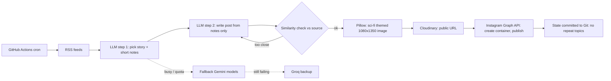

# Automated AI Content Pipeline for Instagram

A serverless pipeline that researches, writes, designs and publishes tech content to Instagram on a schedule, with no server and no manual steps. It runs entirely on GitHub Actions and free-tier APIs.

> **Status:** running in production on a personal account. Built with AI-assisted development (Claude); setup, API integrations, debugging and operation by the repository owner.

## What it posts

| Slot | When (IST) | Content |
|---|---|---|
| News | 09:00 daily | One AI / technology story, rewritten in original wording, source credited |
| Idea | 18:00 daily | One innovative technology idea, clearly framed as a concept |
| Extra | random times, 1-2 per day | Robotics, electronics, mechatronics, sci-fi tech, new innovation (real news or an explainer) |
| Maintenance | weekly | Instagram access token refresh |

## Architecture



## Key engineering decisions

- **Serverless scheduling:** GitHub Actions cron, `workflow_dispatch` for manual runs and dry runs, concurrency group so runs never overlap.
- **Two-step LLM writing:** the model first reduces the article to short notes, then writes the post from those notes only. It never sees the source sentences, which reduces copying.
- **Originality guard:** longest-shared-word-run check against the source text; the post is rewritten if it is too close. Sources are credited in the caption.
- **Accuracy rules in prompts:** no invented numbers or quotes, keep the exact scope of the source, no opinions or predictions.
- **Duplicate prevention:** posted links and topic headlines are stored in `posted.json` and passed back into the prompt.
- **Reliability on free tiers:** retry with backoff on 429/503, automatic switch between several Gemini models, failover to Groq, workflow-level retries, and no retry when Instagram rejects a post.
- **Programmatic design:** 8 sci-fi / anime-style themes drawn with Pillow (synthwave, cyber city, hologram, aurora, circuit board, matrix, manga burst, sunset); the theme rotates so consecutive posts look different.
- **Random posting times:** several cron triggers per day, and a gate in the script that picks which ones actually post, capped per day.
- **Token lifecycle:** weekly refresh of the long-lived Instagram token and automatic update of the repository secret.
- **Optional Reels:** image to vertical video with FFmpeg, text-to-speech voice-over (edge-tts / gTTS), timed subtitles and generated background music.
- **Diagnostics:** a `diagnose` workflow action reports token validity and Instagram publishing quota without printing secrets.

## Tech stack

Python 3.12 · GitHub Actions · Google Gemini API · Groq API · Instagram Graph API (Instagram Login) · Cloudinary · Pillow · FFmpeg · edge-tts / gTTS · feedparser · requests

## Repository layout

```
main.py                        # whole pipeline
requirements.txt
.github/workflows/instagram.yml
.gitattributes                 # union-merge for log.csv
posted.json, log.csv           # state (auto-committed by the workflow)
```

## Setup (summary)

1. Create a Meta developer app with the Instagram API (Instagram Login) use case and add your professional account as a tester. Generate an access token with `instagram_business_basic` and `instagram_business_content_publish`.
2. Create a Gemini API key (Google AI Studio), a Groq API key (optional backup), and a Cloudinary account with an **unsigned** upload preset.
3. Add repository **secrets:** `GEMINI_API_KEY`, `GROQ_API_KEY` (optional), `IG_USER_ID`, `IG_ACCESS_TOKEN`, `CLOUDINARY_CLOUD_NAME`, `CLOUDINARY_UPLOAD_PRESET`, `GH_PAT` (fine-grained token with *Secrets: read and write*, used to store the refreshed Instagram token).
4. Optional **variables:** `IG_HANDLE`, `POST_LANGUAGE`, `EXTRA_PER_DAY`, `REELS` (`off` / `extra` / `all`), `GEMINI_MODEL`.
5. Run the workflow manually with **dry_run** ticked first and check the preview artifact.

Never commit tokens or API keys; they live only in GitHub Secrets.

## Limitations

- Facts are not independently verified; a periodic manual spot-check is recommended.
- Free-tier AI APIs can be slow or rate limited; the pipeline handles this but a post can still fail and will be retried at the next run.
- Instagram's API can apply temporary blocks to accounts that publish heavily, so daily volume is kept modest.

## Screenshots


